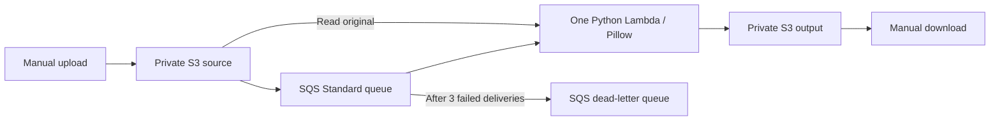

# Serverless Image Processing Pipeline

**AWS Solutions Architect Associate — Graduation Project 2**

A minimal, event-driven image processing application using Amazon S3, Amazon SQS,
and AWS Lambda. Upload an image to a private source bucket; Lambda resizes it, adds
a watermark, and saves a JPEG in a separate private output bucket.

**Deployment status:** source-code submission; no live AWS deployment or endpoint is provided.
Reviewers can run the image processor locally without AWS credentials, or follow the deployment
walkthrough to evaluate the complete event-driven flow in their own AWS account.

## Repository contents

- `app.py` — image processing and SQS-triggered Lambda handler.
- `requirements.txt` — pinned Pillow dependency for the Lambda deployment package.
- `README.md` — architecture, setup, evaluation instructions, and limitations.

## Diagram



### What it does

- Upload a static JPEG, PNG, or WebP under `uploads/` in the source bucket.
- Make **one** watermarked JPEG, fitting within 1280 × 1280 without stretching or upscaling.
- Store it under `processed/` in a different private bucket. `uploads/cat.png` becomes
  `processed/cat.png.jpg`. Keeping the original extension avoids name collisions.
- Reject inputs over 5 MiB, 16 megapixels, or animated images. Strip EXIF/GPS metadata.
- Retry failed queue messages, then move them to the DLQ. Inspect errors in Lambda logs.

**Scope and limitations:** use a different filename for every upload. There is no database,
progress tracking, source version pinning, or per-user access model. Duplicate notifications
rewrite the same output path. If you overwrite an input before it is processed, the latest
object may be processed instead. Keep uploads to a small, trusted demo; do not upload secrets.

This implementation focuses on the assignment's core S3 → SQS → Lambda → S3 flow.
Step Functions, API Gateway, DynamoDB, CloudFront, and SNS are intentionally outside its scope.
Uploads and downloads use the AWS console or CLI; there is no public frontend or API.

## Local evaluation — no AWS account required

Requires Python 3.12 or newer. Clone the repository, enter its directory, then run:

```bash
python -m venv .venv
source .venv/bin/activate
python -m pip install -r requirements.txt boto3
```

Place a supported image named `photo.png` in the directory, then process it locally:

```bash
python -c 'from pathlib import Path; from app import process_image; Path("output.jpg").write_bytes(process_image(Path("photo.png").read_bytes()))'
```

Open `output.jpg`. Expected result: the original proportions are preserved, neither side exceeds
1280 pixels, and a `Manara` watermark appears near the lower-right corner. A smaller image is
not enlarged. Transparent areas become white; original EXIF/GPS metadata is not copied.

The local command performs only the image transformation. It does not call AWS, use credentials,
or exercise S3/SQS delivery. For negative evaluation, pass an invalid file or a file larger than
5 MiB to `process_image`; it raises an exception rather than producing an output.

`boto3` is needed locally because `app.py` imports it, but AWS clients are created only when the
Lambda handler processes an S3 event. Lambda's Python runtime already includes boto3, so it is
not bundled in `requirements.txt`.

## AWS deployment walkthrough

Requires an AWS account, permission to create the listed resources and IAM role, and the AWS
CLI only if using the command-line evaluation steps. Use your own authenticated AWS profile.
Create all resources in the same region (for example, `us-east-1`). Deployment incurs charges;
review the cost section before starting. The following steps use the AWS console:

1. **Two S3 buckets:** one for inputs, one for outputs. Keep Block Public Access enabled,
   ACLs disabled, and default SSE-S3 encryption. Add lifecycle expiration rules: source after
   1 day, outputs after 7 days. Do not enable versioning for this disposable demo.
2. **Two SQS Standard queues:** a work queue and a DLQ. Keep SQS-managed encryption enabled.
   Set the work queue's visibility timeout to 180 seconds, retention to 1 day, and redrive policy
   to the DLQ after 3 receives. Give the DLQ 7-day retention. In its redrive allow policy,
   allow only the work queue to use this DLQ.
3. **S3 → SQS:** in the work queue access policy, allow `s3.amazonaws.com` to `sqs:SendMessage`
   only from the input bucket ARN and your account ID (example below). In the input bucket's
   event notifications, send all object-created events with prefix `uploads/` to the work queue.
4. **One Lambda:** Python 3.13, x86_64, 512 MB, 30-second timeout, handler `app.handler`.
   Upload the package described below. Set `SOURCE_BUCKET` and `OUTPUT_BUCKET` environment
   variables to your bucket names. Set its CloudWatch log retention to 1 day.
5. **Lambda execution role:** trust `lambda.amazonaws.com`; attach `AWSLambdaBasicExecutionRole`
   for logs, plus the scoped data policy below. No developer credentials inside the function.
6. **SQS trigger:** connect the work queue to Lambda, batch size 1, maximum concurrency 2.
   Enable **Report batch item failures**. Without it, Lambda could acknowledge a failed job.
7. **Demo:** upload a small image to `uploads/example.png`, then check the output bucket and
   download `processed/example.png.jpg`. A text file uploaded to the same prefix should fail
   and eventually appear in the DLQ. Do not repeatedly retry invalid files by hand.

Replace `REGION`, `ACCOUNT_ID`, `INPUT_BUCKET`, `OUTPUT_BUCKET`, and `WORK_QUEUE` below.

Work queue resource policy:

```json
{
  "Version": "2012-10-17",
  "Statement": [{
    "Effect": "Allow",
    "Principal": {"Service": "s3.amazonaws.com"},
    "Action": "sqs:SendMessage",
    "Resource": "arn:aws:sqs:REGION:ACCOUNT_ID:WORK_QUEUE",
    "Condition": {
      "ArnEquals": {"aws:SourceArn": "arn:aws:s3:::INPUT_BUCKET"},
      "StringEquals": {"aws:SourceAccount": "ACCOUNT_ID"}
    }
  }]
}
```

Lambda role inline data policy:

```json
{
  "Version": "2012-10-17",
  "Statement": [
    {"Effect":"Allow","Action":"s3:GetObject","Resource":"arn:aws:s3:::INPUT_BUCKET/uploads/*"},
    {"Effect":"Allow","Action":"s3:PutObject","Resource":"arn:aws:s3:::OUTPUT_BUCKET/processed/*"},
    {
      "Effect":"Allow",
      "Action":["sqs:ReceiveMessage","sqs:DeleteMessage","sqs:GetQueueAttributes"],
      "Resource":"arn:aws:sqs:REGION:ACCOUNT_ID:WORK_QUEUE"
    }
  ]
}
```

For **each** bucket, apply the following HTTPS-only bucket policy, replacing `BUCKET_NAME`
with that bucket's name. Both buckets must remain private:

```json
{
  "Version": "2012-10-17",
  "Statement": [{
    "Effect": "Deny",
    "Principal": "*",
    "Action": "s3:*",
    "Resource": ["arn:aws:s3:::BUCKET_NAME", "arn:aws:s3:::BUCKET_NAME/*"],
    "Condition": {"Bool": {"aws:SecureTransport": "false"}}
  }]
}
```

### Package for Lambda (local build only, not deployment)

Pillow contains native code. Package Linux/Python 3.13 wheels, not your desktop's installed Pillow.
Run from this directory in your virtual environment. Use a fresh, empty `package/` directory:

```bash
python -m pip install --target package --only-binary=:all: --platform manylinux_2_28_x86_64 --python-version 3.13 --implementation cp --abi cp313 -r requirements.txt
cp app.py package/
```

Zip the **contents** of `package/`, with `app.py` at the ZIP root, and upload that ZIP to Lambda.
For example, on Linux/macOS with the `zip` utility:

```bash
cd package
zip -qr ../function.zip .
cd ..
```

Lambda already includes boto3, so only Pillow is bundled. No layer, container image, or build service.

## Evaluate the deployed pipeline

Replace `YOUR_PROFILE`, `INPUT_BUCKET`, and `OUTPUT_BUCKET` with your own values:

```bash
aws s3 cp photo.png s3://INPUT_BUCKET/uploads/photo.png --profile YOUR_PROFILE
aws s3 ls s3://OUTPUT_BUCKET/processed/ --profile YOUR_PROFILE
aws s3 cp s3://OUTPUT_BUCKET/processed/photo.png.jpg result.jpg --profile YOUR_PROFILE
```

Processing is asynchronous. Repeat the list command after a short interval if the result is
not present yet. Open `result.jpg` and check its dimensions and watermark.

To evaluate failure handling, upload a plain text file under `uploads/` with a new filename.
Lambda logs the error; after three failed receives the message moves to the DLQ. This takes
multiple visibility-timeout intervals. A valid job should not enter the DLQ.

If no output appears, check the Lambda log group and trigger status, confirm the bucket
environment variables, and verify the queue policy and execution role. Error messages identify
the failed SQS message. Repair configuration errors before redriving DLQ messages. If the
original image has already expired, upload it again under a new key instead of redriving.

## Cost considerations

This design avoids databases, customer-managed KMS keys, paid alarms, load balancers, and
provisioned compute. Keep the evaluation to a few small images and remove resources afterward.
There is no public upload endpoint; bucket access requires AWS authorization.

**No fixed cost or Free Tier eligibility is guaranteed.**
S3 storage/requests/downloads, Lambda execution, SQS polling/requests, and CloudWatch logs can
still incur charges, including idle queue polling. Stop/remove the SQS trigger when not testing.
Lifecycle cleanup is asynchronous. Budget alerts are delayed and do not stop spending.
Before deployment, check current pricing and account eligibility:
[S3](https://aws.amazon.com/s3/pricing/), [Lambda](https://aws.amazon.com/lambda/pricing/),
[SQS](https://aws.amazon.com/sqs/pricing/), [CloudWatch](https://aws.amazon.com/cloudwatch/pricing/).

## Cleanup — only when intentionally removing the demo

Remove the Lambda's SQS trigger first. After saving any wanted images, empty and delete the
two project buckets, delete both queues and the Lambda, then its dedicated role and log group.
Do not remove unrelated resources. Check billing afterward; this folder does not create resources
or budget alerts on its own.
