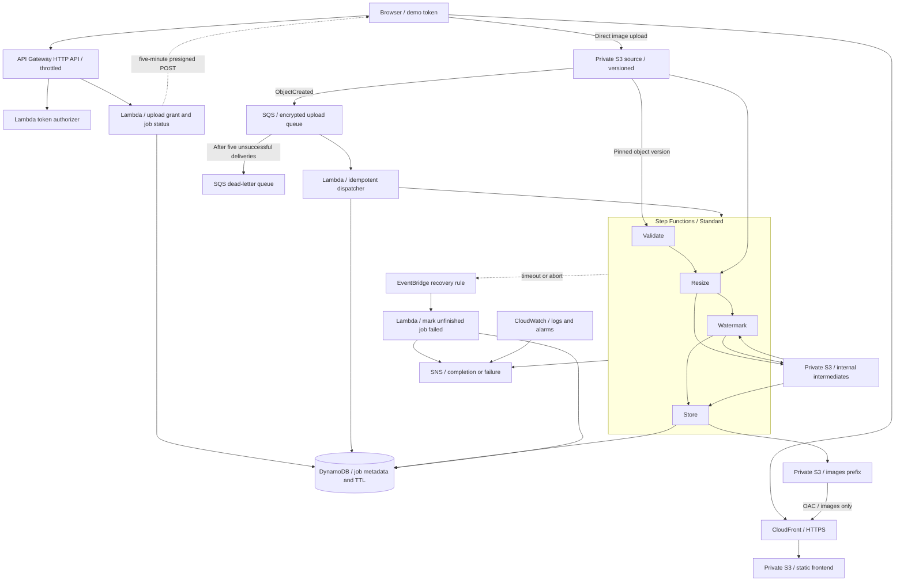

# Frame — Serverless Image Processing

An AWS Solutions Architect Associate graduation project for Manara (Project 2).
Upload an image, follow its progress, and receive a thumbnail and a large watermarked JPEG,
delivered through CloudFront. No EC2 instances, NAT Gateways, or always-running containers.

**Branches:** `main` contains this full implementation. For the compact S3 → SQS → Lambda
submission, see the [`minimal` branch](https://github.com/HazemBZ/manara-image-pipeline-minimal/tree/minimal).

## Deployment status

**Source-code submission; not deployed.** No live endpoint is provided. Local implementation
checks, Terraform validation/planning, and AWS state-machine definition validation have passed;
the complete deployed flow has not been verified. Reviewers can preview the frontend locally or
follow the deployment instructions in their own AWS account to evaluate the complete application.

## Architecture



The diagram is editable Mermaid in this README; GitHub renders it directly. For the processing
sequence, see [docs/workflow.mmd](docs/workflow.mmd).

### Request lifecycle

1. The user supplies a private demo token. A Lambda authorizer checks its SHA-256 hash.
2. `POST /uploads` creates an `AWAITING_UPLOAD` job and returns a presigned S3 POST valid
   for five minutes, constrained to one key, MIME type, and exact file size.
3. The browser uploads directly to S3. Image bytes never pass through API Gateway.
4. S3 sends an event to SQS. The dispatcher pins the source **version ID** in DynamoDB and starts
   a Standard execution named after the job. Duplicate events do not create duplicate workflows.
5. Four Lambda tasks validate the image, resize both variants, watermark them, and copy the
   finished files into the publishable prefix. Only then does the job become `COMPLETED`.
6. The frontend polls `GET /jobs/{job_id}` and displays the CloudFront result links.
7. SNS publishes a small success/failure message. An optional email subscriber receives it after
   subscription confirmation. No original filenames or image contents are put into notifications.

## Features and limits

- JPEG, PNG, and WebP input; maximum **10 MiB** and **20 megapixels** (application limits).
- Static images only; animated files and MIME-spoofed/corrupt images are rejected.
- Thumbnail: fits **320 × 320**. Large: fits **1920 × 1920**. Aspect ratio preserved, no upscaling.
- Both outputs are JPEG; transparency is flattened onto white, EXIF/GPS metadata removed.
- Configurable text watermark; default `Manara`.
- Source object versioning prevents an overwritten upload from silently changing a running job.
- SQS retries, partial-batch failure handling, DLQ, SDK retries, Step Functions transient retries.
- Whole-execution timeouts/aborts are handled by an EventBridge recovery rule.
- Scoped IAM roles per function, encrypted storage/queues/notifications, HTTPS-only buckets,
  Block Public Access, disabled S3 ACLs, and CloudFront Origin Access Control.
- CloudWatch logs/alarms; optional paid CloudFront WAF rate rule.

**Access/privacy:** this is a restricted single-group demo, not a multi-user product. The upload
and status API require the shared token. Anyone who holds that token can query any known job ID.
The frontend itself and processed images are publicly viewable through CloudFront; output IDs
are random, but an unguessable URL is **not** authorization. Originals and intermediates are never
exposed through CloudFront. Use only non-sensitive demonstration images. A production/private
variant should add Cognito, per-user ownership, CloudFront signed URLs, and stronger abuse controls.

## Repository layout

```text
frontend/            Static upload page (plain HTML/CSS/JS, no build step)
src/pipeline/        API, authorizer, dispatcher, image tasks
infra/               Terraform infrastructure and locked AWS provider
scripts/build.py     Build handler ZIP + Linux/Python 3.13 dependency layer
scripts/setup_token.py  Local demo-token generation (hash only deployed)
docs/                Design decisions, sequence diagram, operations/demo guide
```

## Local setup

Requires Python 3.12+, pip, Node.js (syntax check only), AWS CLI v2, and Terraform 1.10+.
The Lambda runtime is Python 3.13/x86_64; the layer builder downloads matching Linux wheels
even when the local Python version is different. No Docker daemon is required for the build.

```bash
python -m venv .venv
source .venv/bin/activate
python -m pip install -e .
node --check frontend/app.js
python scripts/build.py
```

Runtime dependencies and their transitive versions are pinned in `requirements-lambda.txt`.
Build hashes go in `build/manifest.json`. Artifacts, state, tokens, and local configuration
are git-ignored. Only source, dependency definitions, and reviewer documentation are published.

For a UI-only preview:

```bash
python -m http.server 8765 --bind 127.0.0.1 --directory frontend
```

Visit `http://127.0.0.1:8765`. It clearly reports that the backend is not deployed; it does not
pretend to process files locally. Production `config.json` is created by Terraform, not committed.

## Deploy

Deployment creates billable resources. Set an AWS budget/alerts first and review
[cost and security decisions](docs/decisions.md). Alerts do not stop spending.
The full implementation includes recurring KMS, monitoring, and backup costs even when idle;
use the `minimal` branch for the smaller demonstration architecture.

1. Verify the intended identity and region (never use root keys):

   ```bash
   aws sts get-caller-identity --profile YOUR_PROFILE
   aws configure get region --profile YOUR_PROFILE
   ```

2. Build and configure:

   ```bash
   python scripts/build.py
   python scripts/setup_token.py
   cp infra/terraform.tfvars.example infra/terraform.tfvars
   ```

   Edit `infra/terraform.tfvars` for your own `aws_profile`, region, project name, watermark,
   and optional notification email. The default region is `us-east-1`. Keep WAF disabled unless
   its additional cost has been approved. Its rate limit applies to CDN traffic, **not** the
   directly accessed API; the API has separate authentication and throttling.

3. Review and deploy:

   ```bash
   terraform -chdir=infra init
   terraform -chdir=infra fmt -check
   terraform -chdir=infra validate
   terraform -chdir=infra plan -out=../build/deployment.tfplan
   terraform -chdir=infra apply ../build/deployment.tfplan
   terraform -chdir=infra output
   ```

   CloudFront propagation takes time. The deployment principal needs permissions to manage
   project S3, Lambda, API Gateway, IAM, DynamoDB, SQS, SNS, KMS, Step Functions, EventBridge,
   and CloudWatch resources; WAF permissions are needed only when enabled. Scoped runtime
   roles are created by Terraform, rather than reusing your developer credentials.

4. Confirm the SNS subscription email, if one was configured. The pipeline still publishes
   notifications without an email subscriber, but no email is delivered.

5. Open the `website_url` output and paste the contents of `.secrets/demo-token` into the
   access-token input. Do not show the token in screenshots, terminal recordings, or GitHub.

6. Evaluate the deployed application:

   - Upload a non-sensitive JPEG, PNG, or WebP through the frontend and note the displayed job ID.
   - Wait for completion, then open both output links. Verify thumbnail/large size limits,
     preserved proportions, the watermark, and removal of original EXIF/GPS metadata.
   - In Step Functions, find the execution named after the job ID and inspect its four processing
     stages. The corresponding DynamoDB item should be `COMPLETED` with image dimensions.
   - For the failure path, upload a corrupt, nonempty file with a `.png` extension. The workflow
     should mark the job `FAILED`; inspect its validation error in the execution history/logs.
     This deliberately failed execution may trigger an alarm. It should not put a message on
     the ingestion DLQ: invalid **image content** is handled inside the workflow; the DLQ is
     for messages that cannot be **dispatched** after retries.
   - If email was configured and confirmed, verify the completion/failure notification.

### Token rotation

Run `python scripts/setup_token.py --rotate`, review a fresh plan, and apply. The old token
stops working after the authorizer update; clients must use the new token. No token is
embedded in the frontend or Terraform state (the SHA-256 hash is stored there).

### API

Both endpoints require `Authorization: Bearer <demo-token>`.

```http
POST /uploads
Content-Type: application/json

{"content_type":"image/png","size":12345}
```

Returns `201` with `job_id`, `upload.url`, `upload.fields`, and `expires_in`. Submit those
fields as multipart form data, with the file field last, to the S3 URL.

```http
GET /jobs/<32-character-job-id>
```

Returns `AWAITING_UPLOAD`, `QUEUED`, `PROCESSING`, `COMPLETED`, or `FAILED`. Completed responses
include metadata and output image URLs. Expired metadata is treated as absent even before
DynamoDB asynchronously deletes it. An expired upload grant has an `upload_expired` hint.

## Operations and cleanup

See [docs/runbook.md](docs/runbook.md) for failure handling, DLQ redrive, the demo checklist,
and cleanup. Defaults retain original versions about 7 days, intermediates about 1 day,
and results/metadata about 30 days. Lifecycle/TTL deletion is asynchronous, not an exact deadline;
cached results may remain at the edge for up to a day after an origin object is removed.

Buckets refuse deletion while nonempty by default. **Destroying infrastructure does not
replace a deliberate decision about deleting image data.** Save needed data before cleanup.
Terraform state is local for this single-developer demo. Protect it and back it up privately;
use a private encrypted remote backend with locking before collaborating.

## Review scope

This branch includes the full architecture, application source, infrastructure definition,
dependency packaging, and operational documentation. The Mermaid architecture diagram above
and [processing sequence](docs/workflow.mmd) are editable in the repository. No live deployment
or recorded demonstration is claimed; the instructions above describe how a reviewer can
deploy and evaluate the application in their own account.
